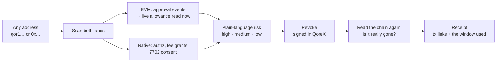
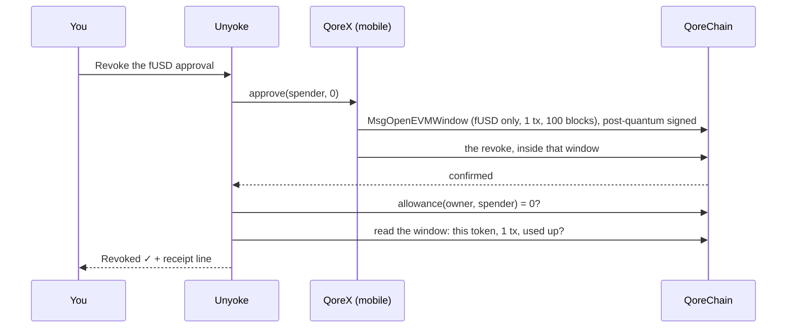
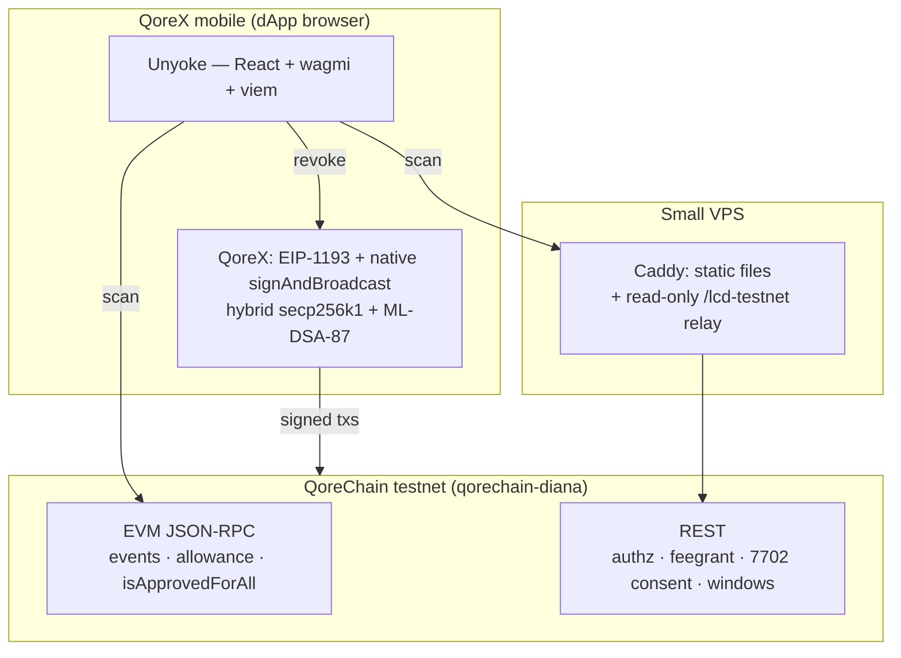

# Unyoke

**See every permission your QoreChain account has given away, and take it back.**

A QoreChain account can hand out *standing permissions*: a token approval to a contract, an authz grant that lets another address act for you, a fee grant that spends your QOR, an EIP-7702 consent that lets a contract run as your account. Each one keeps working until you remove it, long after you've forgotten the app that asked. They live on two different lanes of the chain, so no single tool showed them all.

Unyoke reads both lanes for any address, tells you in plain words what each permission can do and how risky it is, and removes it in one tap from the QoreX wallet. After each removal it reads the chain again to prove the permission is gone, then adds it to a receipt you can keep.

- **Try it:** https://unyoke.duckdns.org (QoreChain testnet; scan any address, revoke your own from the QoreX app)
- **Built for:** [Build Before Q-Day](https://build.qorechain.io), the **Quantum Pass** track
- **Proven on testnet:** every kind of revoke below has a real transaction in [Proven on testnet](#proven-on-testnet)
- **No keys, no server, no database.** Unyoke is a static site. Your wallet signs; Unyoke only reads.

---

## Contents

[The problem](#the-problem) · [What Unyoke does](#what-unyoke-does) · [What it finds](#what-it-finds) · [How risk is rated](#how-risk-is-rated) · [Try it in two minutes](#try-it-in-two-minutes) · [How a revoke is signed](#how-a-revoke-is-signed) · [Proven on testnet](#proven-on-testnet) · [How it compares](#how-it-compares) · [Why it matters for Q-Day](#why-it-matters-for-q-day) · [Trust model and limits](#trust-model-and-limits) · [Architecture](#architecture) · [Run it](#run-it) · [Roadmap](#roadmap)

---

## The problem

**Most wallet theft doesn't break anything. It uses a permission the owner signed.** Scam Sniffer counted **$83.85M stolen from 106,106 victims in 2025** through signature phishing on EVM chains, after **$494M in 2024**. The largest cases were token approvals and permits (up to $6.5M from one signature), `setApprovalForAll` on NFTs ($1.23M), and, new in 2025, **malicious EIP-7702 delegations** ($2.54M in two cases) ([Scam Sniffer 2025 report](https://drops.scamsniffer.io/scam-sniffer-2025-crypto-phishing-losses-fall-83-to-84-million/)). Their own count is a lower bound: it only covers drainers they could trace.

QoreChain inherits all of that through its EVM lane, and adds a second lane with permissions of its own:

| Lane | Standing permission | What it lets someone else do | Expires? |
|---|---|---|---|
| EVM | ERC-20 `approve` | Move your tokens, often an unlimited amount | Never |
| EVM | ERC-721/1155 `setApprovalForAll` | Move every NFT in the collection, including future ones | Never |
| Native | `authz` grant | Send messages as you: transfers, staking, votes | Only if a date was set |
| Native | Fee grant | Spend your QOR on their transaction fees | Only if a date was set |
| Native | EIP-7702 consent | Run a contract's code as your EVM account | Until its expiry height |

Three things make this worse on QoreChain than on a single-lane chain:

1. **Nothing lists both lanes.** EVM revoke tools can't see `authz`, fee grants or QoreChain's 7702 consent, and can't sign native messages. The native lane only offers raw REST endpoints and the command line.
2. **QoreChain's post-quantum guard doesn't cover old approvals.** Every EVM transaction needs a short authorisation window opened with the account's ML-DSA-87 key. That window limits *sending* transactions, but an approval granted through it stays open after the window is used up. We checked: the window for our test approval was used up by that one transaction, and the allowance stayed open until Unyoke revoked it ([txs below](#proven-on-testnet)).
3. **Old history disappears.** The public testnet node keeps history only from block 8,790,799. Approvals set before that can't be found from history by anyone using it. Unyoke says so instead of showing a false "all clear".

## What Unyoke does



1. **Scan.** Paste a `qor1…` or `0x…` address (they're the same account), connect a wallet, or try the sample account. Scanning is read-only and works for anyone's address.
2. **Understand.** Each permission gets a card: who holds it, what it can do in one sentence, whether it's unlimited or never expires, and a risk level.
3. **Revoke.** One button per permission, or **Revoke all high risk**. Each is a separate approval in your wallet; Unyoke never batches anything you didn't see.
4. **Verify.** After the transaction confirms, Unyoke reads the allowance or the grant again. Only then does it say **Revoked ✓**.
5. **Keep a receipt.** Every removal is listed with its transaction and, for token revokes, the exact window QoreX opened ("this token only, 1 tx, used up"). **Copy receipt** gives you a markdown table.

## What it finds

| Permission | How Unyoke finds it | How it's removed |
|---|---|---|
| ERC-20 approvals | `Approval` events from the account, in 10,000-block chunks, 4 at a time; then the **live** `allowance()` for each pair, so spent or replaced approvals drop out | `approve(spender, 0)` |
| NFT approve-all | `ApprovalForAll` events, then the live `isApprovedForAll()` | `setApprovalForAll(operator, false)` |
| `authz` grants | `GET /cosmos/authz/v1beta1/grants/granter/{addr}` | `MsgRevoke` |
| Fee grants | `GET /cosmos/feegrant/v1beta1/issued/{addr}` | `MsgRevokeAllowance` |
| EIP-7702 consent | `GET /qorechain/pqc/v1/evm_delegation_consent/{addr}` | `MsgClearEVMDelegation` |

Each approval also shows the token's name and decimals, your current balance, whether the spender is a contract or an ordinary wallet, and the block and transaction that set it. Scanning the whole kept history (about 1.47 million testnet blocks) takes around 20 seconds.

**Not included on purpose:** linked keys. Another Build Before Q-Day project already handles revoking those, and Unyoke shouldn't duplicate it.

## How risk is rated

The rules live in one tested file ([`src/lib/risk.ts`](src/lib/risk.ts)), so they're easy to read and argue with. **"Low" never means safe**; it means no strong warning signs were found.

| High | Medium | Low |
|---|---|---|
| Unlimited token approval | Covers your whole current balance | Limited approval to a contract |
| Spender is an ordinary wallet, not a contract | Approval older than about a week | Vote-only `authz` grant |
| NFT approve-all | `authz` that can move your stake | Fee grant with a spending limit |
| `authz` that can send funds, or that Unyoke can't read | Fee grant with no limit | Expired 7702 consent |
| Live EIP-7702 consent | | |

"Never expires" is added as a reason wherever it applies.

## Try it in two minutes

You don't need any permissions of your own to see Unyoke work:

1. Open https://unyoke.duckdns.org/app in the **QoreX app's built-in browser**, on testnet, and scan your own account.
2. Scroll to **Testnet sandbox** and tap one of: **Unlimited fUSD approval**, **Authz grant (vote, no expiry)** or **Fee grant (no limit)**. Each goes to `0x…dEaD`, an address nobody controls, using worthless testnet tokens. Unyoke scans again when it's done.
3. Tap **Revoke** on the new permission, approve it in QoreX, and watch the status go *signing → confirming → verifying → Revoked ✓*.
4. Read the receipt at the bottom.

Need testnet QOR? Use the [faucet](https://docs.qorechain.io/dashboard/faucet).

## How a revoke is signed

QoreChain admits an EVM transaction only if the sender has a registered **ML-DSA-87** key and a live **EVM authorisation window**, both set on the native lane with the post-quantum key. We tested what that means for a website ([full results](docs/SPIKE_RESULTS.md)):

- **Websites can't open or close windows.** QoreX refuses `MsgOpenEVMWindow` from a site ("managed by the wallet itself") and won't sign `MsgCloseEVMWindow`.
- **QoreX mobile opens one window per EVM transaction, by itself,** limited to the one contract being called, **1 transaction, 100 blocks**, and a value cap equal to that transaction's fee. That's tighter than anything Unyoke could have asked for, so Unyoke simply reads the window back and shows it on the receipt.
- **Native revokes are signed with the hybrid secp256k1 + ML-DSA-87 signature** through QoreX's `signAndBroadcast`.



## Proven on testnet

All from the QoreX iOS app on `qorechain-diana`, account `qor178yef…mzu` (`0xF1C9…8082`), through Unyoke's own interface on 17 November 2026. Transactions are Cosmos hashes; on the [explorer](https://explore.qore.network), choose **Testnet** at the top first.

| What | Transaction |
|---|---|
| Sandbox: `authz` grant (vote, no expiry) | `F36A89B960E8A6FDD8477039AA0CC9F6F8709450461FAA39D6AC31B74175F93D` |
| **Unyoke revokes it** (`MsgRevoke`, hybrid-signed) | `7D4F9DEF11A7567297E38E13202F4A56C6C885F110816A149EE114CE3A6633B2` |
| QoreX opens a window: fUSD only, 1 tx | `B91C990FF7B5C29727B1567136B57F4F2459B1530B01060666398873C51AD0D9` |
| Sandbox: unlimited fUSD approval to `0x…dEaD` (uses up that window) | `3E3542495D6ED73E5FE9A4B0D144C41018BC2DC9070389A5FE59548A6E65135B` |
| Sandbox: fee grant, no limit | `A1E3282FDEBD97F177A86E422D34C7D4B258BADB6DB41B9CB585E24B27F7D13F` |
| QoreX opens a window for the revoke: fUSD only, 1 tx, 100 blocks | `77C275A27268EB38653CA3B4DAB1A05D967D0506C944B7FC4610212301149077` |
| **Unyoke revokes the approval** (`approve(0x…dEaD, 0)`) | `250959F74706CF4A2D705F5F0B826DA510E2BAADC1EA3E1ECDAD379AFADA6CDF` |
| **Unyoke revokes the fee grant** (`MsgRevokeAllowance`) | `6A2316E94530B1CA9F435C32D8D57566C6726510862DB2D89DC5F67367E15B00` |

The approval and its revoke went through **different** windows, each used up by its single transaction. The allowance stayed open between them: a window protects the moment of sending, not what an approval leaves behind. The first experiments (window refusals, the first approve/revoke, `authz` and fee grant round trips) are in [docs/SPIKE_RESULTS.md](docs/SPIKE_RESULTS.md).

## How it compares

| | **Unyoke** | EVM revoke tools | Wallet approval warnings | Command line (`qorechaind`) |
|---|---|---|---|---|
| ERC-20 and NFT approvals | ✅ find + revoke | ✅ on chains they support | ⚠️ warn at signing time | ❌ |
| `authz` and fee grants | ✅ find + revoke | ❌ can't see the native lane | ❌ | ✅ if you know the commands |
| QoreChain EIP-7702 consent | ✅ find (revoke: see limits) | ❌ | ❌ | ✅ |
| Works on someone else's address (read-only) | ✅ | ✅ | ❌ | ✅ |
| Checks the permission is really gone | ✅ reads it again | Usually not | n/a | ❌ |
| Shows the post-quantum window used | ✅ on the receipt | ❌ | ❌ | ❌ |
| Plain-language risk | ✅ tested rules | Varies | Varies | ❌ |
| Needs a terminal or keys on disk | No | No | No | Yes |

**What we learned from others (not copied):** revoke.cash's list of approvals by token and spender, and Rabby's habit of explaining what a signature does in one sentence. What none of them do is cover both of QoreChain's lanes and prove each removal on chain.

## Why it matters for Q-Day

Build Before Q-Day asks what breaks when quantum computers can recover private keys from public keys. Standing permissions are a quiet part of the answer:

- An approval to an **ordinary wallet** is only as safe as that wallet's secp256k1 key. Once that key can be broken, so can the approval. Unyoke rates these high for that reason.
- Every standing permission is a promise made with **yesterday's keys** that keeps working tomorrow. QoreChain's windows protect new transactions with ML-DSA-87; Unyoke cleans up what was granted before or around them.
- Unyoke's own native revokes are **hybrid-signed** (secp256k1 + ML-DSA-87), and each EVM revoke goes through a **post-quantum-signed window** limited to that one token and one transaction.

## Trust model and limits

- **No keys, ever.** Unyoke never sees a seed phrase or private key. QoreX (or your EVM wallet) shows and signs every transaction.
- **No backend.** The site is static files. The only server-side piece is a Caddy rule that forwards **read-only** requests to the chain's REST API, because that API sends no CORS headers. Anything that tries to write gets `405`.
- **It checks, not trusts.** "Revoked" is shown only after the chain confirms the allowance is 0 or the grant is gone.
- **Every action is yours.** "Revoke all high risk" still asks QoreX once per permission.

**Honest limits:**
- **Testnet only** for now. Mainnet is one setting away (both chains are defined) but hasn't been tested.
- **History is pruned.** Approvals set before block 8,790,799 can't be found through the public node. Unyoke shows this on every scan. An indexer is on the roadmap.
- **Revoking needs the QoreX mobile app** today. The QoreX Chrome extension has no testnet switch and doesn't sign EVM transactions yet; on desktop, Unyoke shows a QR code; your phone camera opens the same scan straight in the QoreX app (through QoreX's `link.qore.network/browse` link), ready to revoke.
- **Clearing 7702 consent isn't tested yet.** Unyoke builds the `MsgClearEVMDelegation` message, but QoreX may refuse to display it, as it does `MsgCloseEVMWindow`. If it does, Unyoke shows that message instead of failing silently.
- **Not audited.** It's a client-side tool with 73 unit tests, and it only ever sends revocations: setting things to zero or removing them.

## Architecture



| Path | What it is |
|---|---|
| `src/lib/scanAccount.ts` | One scan of both lanes, with progress and cancel |
| `src/lib/evmApprovalLogs.ts` | Chunked, concurrent event scan; finds the node's oldest kept block |
| `src/lib/evmApprovalState.ts` | Live allowance, balance, token info, contract check |
| `src/lib/nativePermissions.ts` | Reads and parses `authz`, fee grants and 7702 consent; builds revoke messages |
| `src/lib/risk.ts` | The risk rules |
| `src/lib/revoke.ts` | Revoke calls, permission keys, and reading the window back as evidence |
| `src/lib/explorer.ts` | Explorer links, including EVM hash → Cosmos tx lookup |
| `src/ui/useRevoke.ts` | Sign → confirm → verify → receipt, with clear errors for window refusals |
| `src/ui/` | Landing page, scanner, results, receipt, testnet sandbox, desktop-to-phone QR hand-off |
| `scripts/seed-demo.ts` | Gives a throwaway testnet account a set of permissions for demos |
| `deploy/` | Caddy site and a one-command VPS setup |
| `docs/SPIKE_RESULTS.md` | What QoreX will and won't sign for a website, with transactions |

## Run it

```bash
pnpm install
pnpm dev            # http://localhost:5173 (proxies /lcd-testnet to the REST API)
pnpm test           # 73 unit tests
pnpm typecheck
pnpm build
```

To test from the QoreX app on your phone, which needs HTTPS:

```bash
cloudflared tunnel --url http://localhost:5173   # open the printed https link in QoreX
```

On a VPS that already runs Caddy (other sites are left alone; the config is checked before reloading):

```bash
bash <(curl -fsSL https://raw.githubusercontent.com/phoenix-2203/unyoke/main/deploy/setup.sh)
```

Demo data on a **throwaway** testnet account (never a real one; the script refuses accounts holding more than 50 QOR): put its phrase in a git-ignored `.env.seed` as `SEED_MNEMONIC`, then `pnpm seed:demo`.

## Roadmap

- **Indexer** so approvals older than the node's history are found too.
- **Mainnet**, once revokes are re-tested there.
- **Clear 7702 consent** end to end, or a clear hand-off if QoreX won't display it.
- **Watch mode:** a daily check that alerts when a new high-risk permission appears.
- **Shareable receipts** with a link anyone can verify against the chain.

---

MIT licensed. Built by [phoenix-2203](https://github.com/phoenix-2203) in Ibadan, with Claude: how AI was used is in [AI_USAGE.md](AI_USAGE.md).
